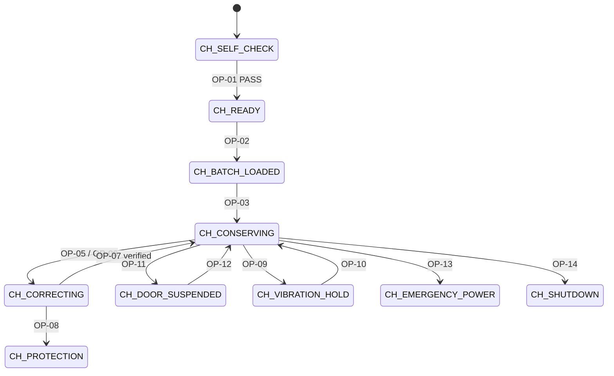

# Task 4.3 – How Operations Change the Chamber State (Link to Task 3)

> Question: Show how at least two operations change the chamber state and link
> them to the Task 3 state model.

## Example 1 – OP-11 HandleDoorOpening (door opened during conservation)

| Step | Chamber | Robot (Task 3) |
|---|---|---|
| Before | CH-CONSERVING | NAVIGATING |
| Event | Door_Open = TRUE | — |
| OP-11 runs | CH-CONSERVING → **CH-DOOR_SUSPENDED** | Constraint C-10 is broken (door open while moving) |
| Signal | Sends SafeModeTrigger (E8) | NAVIGATING → **SAFE_MODE** (T13) |
| Recovery | OP-12 must verify conditions and sensors before CH-CONSERVING | Supervisor reset → RETURNING (T15) |

**Same operation, normal case:** If the robot is in DELIVERING, an open door is the
expected handover, so only a log entry is made and no Safe Mode is triggered.

## Example 2 – OP-08 ActivateProtection (correction failed)

| Step | Chamber | Robot (Task 3) |
|---|---|---|
| Before | CH-CORRECTING (OP-05 running) | NAVIGATING / RETURNING |
| Event | 10-minute recovery period ends; OP-07 says still out of range | — |
| OP-08 runs | CH-CORRECTING → **CH-PROTECTION**; batch Quarantined | — |
| Signal | Sends ChamberCritical as SafeModeTrigger (E8) | Current state → **SAFE_MODE** within 3 s (T13, CR-01) |

## Diagram

